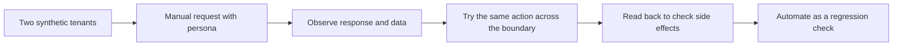
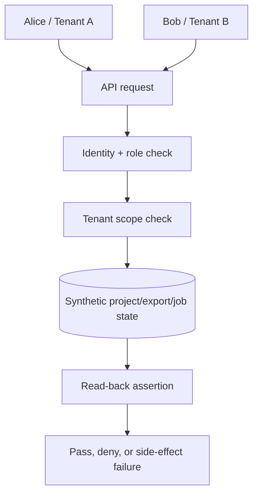

# QualiFi Tenant Isolation Assurance

[](https://github.com/OperaAxe/qualifi-tenant-isolation-assurance/actions/workflows/ci.yml)

## The short version

This project answers a simple but serious SaaS question:

> **Can one customer ever see, change, export, or delete another customer’s data?**

The API is fictional. The risk is not. I use two synthetic companies—Tenant A and Tenant B—and test the same actions a QA engineer would manually test in Postman or through a product UI.

This is not presented as a penetration test. It is a focused regression suite for tenant boundaries and permissions.

## Start here: the manual test

No setup is required to understand the test. Read the permission table, follow the personas, and then look at the passing CI run.

### Step 1: Create two customers in your test data

- **Alice** belongs to Tenant A.
- **Bob** belongs to Tenant B.
- Each tenant has a private project.

The first thing I verify is that the test data really gives us two separate worlds. If the fixture is wrong, a passing test can be meaningless.

### Step 2: List projects as Alice

Alice requests the project list.

**Expected:** she sees the Tenant A project only.

**Failure:** the response includes Bob’s project, even if the UI would normally hide it.

### Step 3: Ask Alice for Bob’s project directly

Take the ID of Bob’s project and request it as Alice.

**Expected:** `404 Resource not found`.

The important part is not the exact status code. The important part is that the server does not return Bob’s data or confirm its existence to Alice.

### Step 4: Try to edit Bob’s project as Alice

Send an update request using Bob’s project ID.

**Expected:** the request is denied, then a second read confirms Bob’s project name did not change.

That second read is essential. A `403` or `404` response alone does not prove that no side effect happened.

### Step 5: Try the same thing with different roles

| Persona | Can read own tenant? | Can create/update? | Can delete? | Can export or manage links? |
|---|---:|---:|---:|---:|
| Owner | Yes | Yes | Yes | Yes |
| Admin | Yes | Yes | Yes | Yes |
| Member | Yes | Yes | No | No |
| Viewer | Yes | No | No | No |
| Other tenant | No | No | No | No |

### Step 6: Test the edges people forget

- Create an export as Alice; confirm it contains Tenant A records only.
- Try to open that export as Bob; it must be unavailable.
- Create a shared link, read it, revoke it, and try the old link again.
- Start a background job as Bob; confirm the result contains Tenant B records only.

## From manual test to automated assurance



| Manual check | Automated oracle |
|---|---|
| Alice lists projects | Every returned record belongs to Tenant A. |
| Alice requests Bob’s ID | The response is denied and Bob’s data is absent. |
| Alice tries to rename Bob’s project | The request is denied and the original name remains. |
| Member tries to delete | The API returns `403` and the project remains. |
| Revoked link is opened | The old token returns `404`. |
| Job result is opened by another tenant | The result is denied and never leaks records. |

## Visual map of the test



## If you want to run it locally

<details>
<summary>Local setup and commands</summary>

```bash
python3.13 -m venv .venv
source .venv/bin/activate
python -m pip install --upgrade pip
python -m pip install -r requirements.txt
pytest
```

Useful selections:

```bash
pytest -m boundary
pytest -m rbac
pytest -m side_effect
```

The synthetic identity is passed with an `X-User` header. The full permission matrix is in `docs/authorization-matrix.md`.

</details>

## Where to look

- `docs/demo-script.md` — the manual walkthrough
- `docs/authorization-matrix.md` — the rule set being checked
- `docs/test-strategy.md` — the test oracles
- `docs/threat-model-and-scope.md` — what this project does and does not claim
- `tests/test_tenant_boundaries.py` — cross-tenant reads and mutations
- `tests/test_rbac.py` — role behavior
- `tests/test_exports_links_jobs.py` — exports, links, and background jobs

## Honest scope

This project does not test a real identity provider, database row-level security, object storage, concurrency, cryptography, or a complete security program. Passing it means the specified examples passed. It does not certify a production SaaS product as secure.
